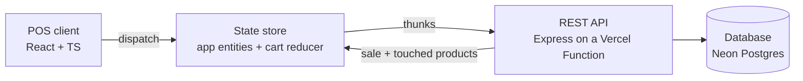

# POS / Management System

Point-of-sale and back-office management interface with inventory and sales flows,
built with **React + TypeScript** on the client and **Node (Express) + TypeScript** on the API.

> Demo store: *Seduh & Co.*, a coffee shop and bakery. Prices in rupiah, PPN 11%.

## Problem

POS screens are used under time pressure: every extra click or confusing state costs the
cashier time and the business money.

## Solution

A frontend built around **predictable state**: the cart is a pure reducer, catalogue data is
normalised, and every CRUD screen shares the same form and table primitives.

## Role

Frontend developer — UI architecture and state management.

## Key decisions

| Decision | Where to look |
| --- | --- |
| **Cart logic as a pure, unit-testable reducer**, independent of UI components. The cart stores only `productId + qty`; it never touches React, `fetch` or the clock. No-op actions return the same state object, so the store skips re-renders. | `client/src/features/cart/cartReducer.ts`, `cartReducer.test.ts` |
| **Normalised client-side entities** (`byId` + `ids`). Prices and names are joined at render time, so editing a product in the back office is reflected instantly in the register grid, the *open* cart and stock alerts. A completed sale updates the `sales` and `products` tables in one action. | `client/src/store/entities.ts`, `appStore.ts`, `features/cart/selectors.ts` |
| **Reusable data-table and form primitives** across all CRUD modules. Products and Categories are each ~60 lines: a column list and a field list handed to `CrudScreen`. | `client/src/components/DataTable.tsx`, `EntityForm.tsx`, `CrudScreen.tsx` |
| **Keyboard-first checkout.** A cashier can run a whole sale without the mouse (see below). | `client/src/features/pos/PosPage.tsx`, `PaymentDialog.tsx` |

Supporting choices:

- **A tiny store, no library.** `createStore` + `useSyncExternalStore` (~50 lines) hosts any pure reducer. The cart store lives outside React, so an open sale survives navigating to Products and back.
- **Integer rupiah everywhere** to avoid floating-point drift. Pricing rules exist once on each side (`pricing.ts`) with matching tests; the **server is the authority** and recomputes totals at checkout.
- **Sale lines are snapshots.** Deleting or repricing a product never rewrites history.
- **Errors are codes, not sentences.** The API returns `{ code, error, fields, details }`; the client translates the code and renders field codes with the form's own label, in English or Indonesian.

## Architecture



### Database

PostgreSQL, with the integrity rules in the schema rather than in route code
(`server/src/db/schema.ts`):

| Table | Notes |
| --- | --- |
| `categories` | unique index on `lower(name)` |
| `products` | `UNIQUE (sku)`, `CHECK (stock >= 0)`, FK to `categories ON DELETE RESTRICT` |
| `sales` | number from a sequence (`S-00001`), totals stored as integers |
| `sale_lines` | snapshot of each line; no FK to `products` on purpose |

**Checkout is one transaction.** Each line runs

```sql
UPDATE products SET stock = stock - $2 WHERE id = $1 AND stock >= $2 RETURNING ...
```

in a fixed id order (no deadlocks between tills). If any line comes back empty, the whole
transaction rolls back and the API answers `409 insufficient_stock` with what's left. Two
tills racing for the last croissant: one sale succeeds, the other gets the 409 (covered by a test).

**Drivers.** `server/src/db/client.ts` hides two drivers behind `query()` / `transaction()`:

- `DATABASE_URL` set → `pg` Pool (Neon), with a 5 s idle timeout and `attachDatabasePool` on Vercel.
- `DATABASE_URL` unset → [PGlite](https://pglite.dev), real Postgres compiled to WASM, stored in `server/.pglite`. Local dev and tests need no database install. PGlite is refused on Vercel, so a missing env var fails loudly instead of losing data.

### Languages

English and Bahasa Indonesia, switchable from the sidebar and remembered per browser
(first visit follows the browser language).

- `client/src/i18n/en.ts` is the source; `id.ts` is typed as `Messages`, so a missing key or a wrong placeholder fails `tsc`.
- `t("pos.left", { count })` is typed: keys with placeholders require their params.
- Money stays in rupiah format (`Rp 28.000`) in both languages; dates follow the chosen language.
- Product and category names are data and are shown as entered.

### REST API

| Method | Path | Notes |
| --- | --- | --- |
| GET | `/api/health` | `{ ok, database, demoReset }` |
| GET / POST | `/api/products` | SKU unique, category must exist |
| PUT / DELETE | `/api/products/:id` | |
| GET / POST | `/api/categories` | name unique (case-insensitive) |
| PUT / DELETE | `/api/categories/:id` | `409 category_in_use` while products use it |
| GET | `/api/sales?limit=` | newest first, lines included |
| POST | `/api/sales` | transactional checkout, returns `{ sale, products }` |
| POST | `/api/demo/reset` | restores the demo catalogue; on locally, opt-in on Vercel |

## Keyboard map (register)

| Key | Action |
| --- | --- |
| `F1` or `/` | Focus search |
| type + `Enter` | Add the highlighted product; an exact SKU always wins |
| `3*latte` + `Enter` | Add three at once |
| `↑` `↓` | With text: choose product. Empty search: choose cart line |
| `+` / `−` | Change quantity of the selected line |
| `Del` | Remove the selected line |
| `F3` | Discount %, `Enter` returns to search |
| `F2` | Charge. In payment, `Enter` with an empty amount = exact money |
| `F4` | Clear sale (with Undo) |
| `Esc` | Clear search / close dialog |

## Run it locally

Requires Node 22.

```bash
npm install
npm run dev        # API on :4000, client on :5173 (proxied /api)
```

Open http://localhost:5173. With no `.env`, the API creates a local Postgres (PGlite) in
`server/.pglite` and loads the demo catalogue. To use Neon locally instead, copy
`.env.example` to `.env` and set `DATABASE_URL`.

```bash
npm test           # reducer, selectors, i18n, pricing + API tests on in-memory Postgres
npm run typecheck
npm run db:setup   # create tables + demo data on DATABASE_URL (safe to re-run)
npm run db:reset   # wipe and restore demo data
```

## Deploy: Vercel + Neon

One Vercel project serves both parts: the Vite build as static files, and Express as a
single Vercel Function (`api/index.ts`). `vercel.json` already sets the build, the
`/api/*` → function rewrite, the SPA fallback and the Singapore region (`sin1`).

1. **Create the database.** In [Neon](https://console.neon.tech), create a project in
   **AWS Asia Pacific (Singapore)** so it sits next to the `sin1` function. Copy the
   **pooled** connection string (host contains `-pooler`).
   *Or* in Vercel: Project → Storage → add **Neon**, which creates the database and sets
   `DATABASE_URL` for you.
2. **Create the tables once**, from your machine:
   ```bash
   cp .env.example .env          # paste DATABASE_URL into .env
   npm run db:setup              # "Schema ready on ep-…neon.tech. Demo data loaded."
   ```
   (If you used the Vercel integration: `vercel env pull .env` first.)
3. **Import the repo in Vercel.** Settings come from `vercel.json`; leave the build fields
   empty. Add environment variables for Production and Preview:
   - `DATABASE_URL` = the pooled Neon string (skip if the integration set it)
   - `ALLOW_DEMO_RESET` = `true` *(optional: shows "Reset demo data" to visitors)*
4. **Deploy**, then open `https://<your-app>.vercel.app/api/health`. It should return
   `"database":"postgres"`.

Schema changes later: edit `schema.ts` (statements are `IF NOT EXISTS`) and run
`npm run db:setup` again against Neon.

## Project structure

```
api/index.ts               Vercel Function entry: exports the Express app
vercel.json                build, rewrites, region
client/src
  api/client.ts            typed fetch wrapper, ApiError { code, fields, details }
  i18n/                    en + id dictionaries, typed t(), error translation
  lib/createStore.ts       store + useStore(selector, isEqual)
  store/                   normalised entities, app reducer, async actions
  features/cart/           pure reducer, pricing, selectors (+ tests)
  features/pos/            register screen, cart panel, payment, search grammar
  components/              DataTable, EntityForm, CrudScreen, Modal, toasts
  pages/                   Products, Categories, Sales
server/src
  app.ts                   Express app (no listen), shared by local + Vercel
  index.ts                 local entry: setup DB, listen, serve built client
  db/                      driver wrapper, schema, setup/seed, row mappers, CLI
  routes/                  products, categories, sales (transactional checkout)
  api.test.ts              API tests against in-memory Postgres
```

## Stack

React · TypeScript · State management · REST API · Node/Express · PostgreSQL (Neon) · Zod · Vite · Vitest · Vercel
# pos-system

